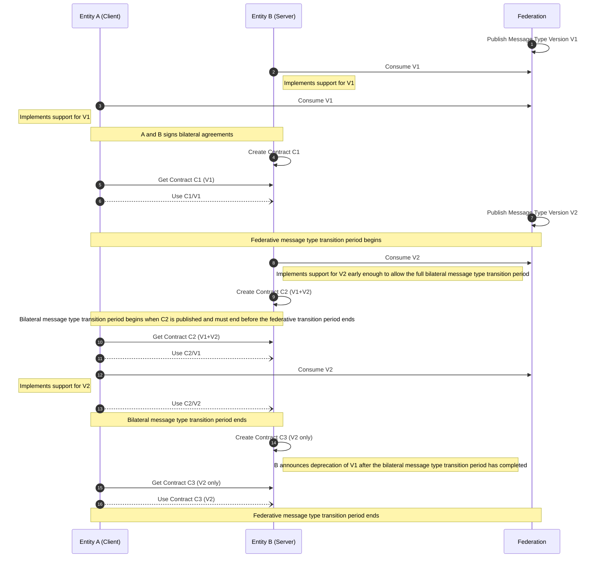

# Handling Bilateral Contracts

This convention governs the lifecycle, override logic, and message type version transition behavior for bilateral contracts exchanged between participants in the FFI federation. It ensures synchronized transitions, prevents fragmentation, and clarifies how contracts are maintained between specific party pairs.

## General Principles

- A bilateral contract governs the interaction between **exactly one client (requestor)** and **one server (respondent)**.
- Each **server defines** which client the contract applies to—**one contract per client**.
- If a server communicates with multiple clients, it must maintain **separate contracts** for each.
- Only one **active** contract exists for any given server-client pair at a time.
- Contracts are **not versioned**. When replaced, the new contract overrides the previous one.
- The active contract is the contract with the most recent `modifiedDate` for the server-client pair.
- The Contract API always returns the **current active** contract for the calling client.

## Override and Replacement Behavior

- A newly created contract for the same client **automatically overrides** the previous one.
- Contracts are always authored and published by the server for a specific client.
- Each contract must have a unique `contractId` (UUID).
- Contracts are immutable after issuance—updates require the creation of a new contract.
- `createDate` records when the bilateral contract relationship was first created. It remains unchanged when a replacement contract is issued.
- `modifiedDate` records when the returned contract representation was issued and became active. For the first contract in a bilateral relationship, `modifiedDate` is equal to `createDate`.
- Clients retrieve their active contract via the Contract API and must comply with its contents.

## Message Type Evolution and Transition

Message types are versioned and published centrally by the federation, with each version defining the full contractual requirement set for a message exchange. This includes the applicable validation schema and any complementary rules required for interoperable behavior. New message type versions require corresponding updates to bilateral contracts to enable phased adoption across participants.

### Federative vs. Bilateral Message Type Transition Periods

- The **federation** defines a global **message type transition period** during which new and previous message type versions may coexist across the network.
- Each **bilateral relationship** follows its own **bilateral message type transition period**, which begins when the server publishes a new active contract that includes the new message type version.
- The server must publish that contract early enough within the federative message type transition period to allow the full bilateral message type transition period to elapse before the federative message type transition period ends.

### Transition Timeline

1. The federation publishes a new message type version (e.g., V2).
2. The **federative message type transition period begins**.
3. The server implements V2 and creates a new contract (e.g., C2) for the client that includes both V1 and V2.
4. The **bilateral message type transition period begins** when contract C2 is published and must be fully contained within the federative message type transition period.
5. The client continues using V1 but retrieves and uses the new contract (C2).
6. The client implements V2 and transitions to using the new message type version under the same contract during the bilateral message type transition period.
7. The server may issue another contract (e.g., C3) that supports only V2 to mark removal of V1 only after the bilateral message type transition has completed and while still operating within the federative transition window.
8. Once all bilateral message type transitions complete, the federation **ends the transition period** and formally deprecates V1.

### Coexistence of Message Type Versions

- A contract may declare support for **multiple message type versions** per message type in its `messageTypeVersions` field.
- This enables staggered adoption and minimizes disruption across the federation.
- Participants are expected to transition their message type usage while adhering to their active bilateral contract.

### Finalization and Deprecation

- Message type version deprecation is handled by issuing new contracts that exclude deprecated versions.
- Deprecation of a message type version at the federation level mandates that future contracts **must not** include that version.
- Server-side publication of a contract that introduces a new message type version must not be delayed so long that the client is left with less than a full bilateral message type transition period before the federative message type transition period ends.
- Once the federative transition period ends, all members must operate using contracts aligned with current message type version standards.

### Message Exchanges During Contract Replacement

A message exchange must be validated and processed according to the bilateral contract that was active when the first message in the exchange was received. Participants must retain the ability to process and respond to messages using message type versions that were valid at the time of request creation, even if later contracts remove support for those versions. Replacing a contract does not invalidate ongoing exchanges that were initiated under the previous contract.

## Federation-Specific Parameters

Defined in the **FFI Federation Configuration Document**:

- **Federative Message Type Transition Period** – The centrally defined maximum period during which two message type versions (e.g., V1 and V2) are allowed to coexist across the federation. This sets the upper time limit for all members to complete migration.
- **Bilateral Message Type Transition Period** – The full migration window between when a server publishes a new contract supporting a new message type version and when both parties are expected to fully operate on that new version. This period varies per consumer-provider pair and must be fully contained within the federative message type transition period.

Refer to the **FFI Federation Configuration Document** for authoritative parameter values.

## Enforcement and Compliance

- Clients and servers **must comply** with the terms of the active contract in place.
- Using deprecated or unsupported message type versions, or failing to update contracts during transition periods, may trigger the **incident management process**.
- Persistent violations may lead to temporary or permanent restrictions on contract exchange or federation participation.

## Visual Example: Message Type and Contract Evolution

